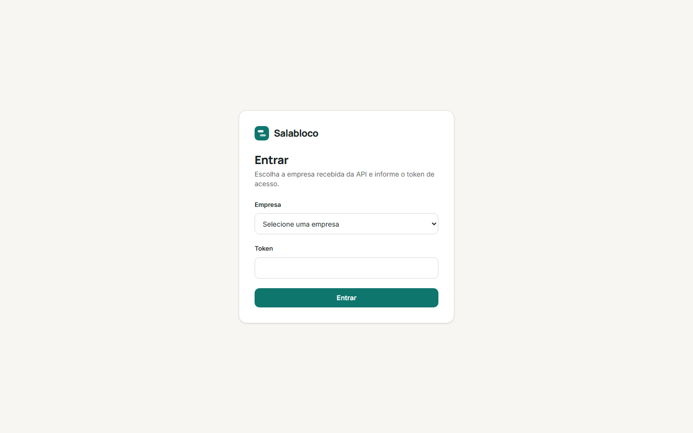
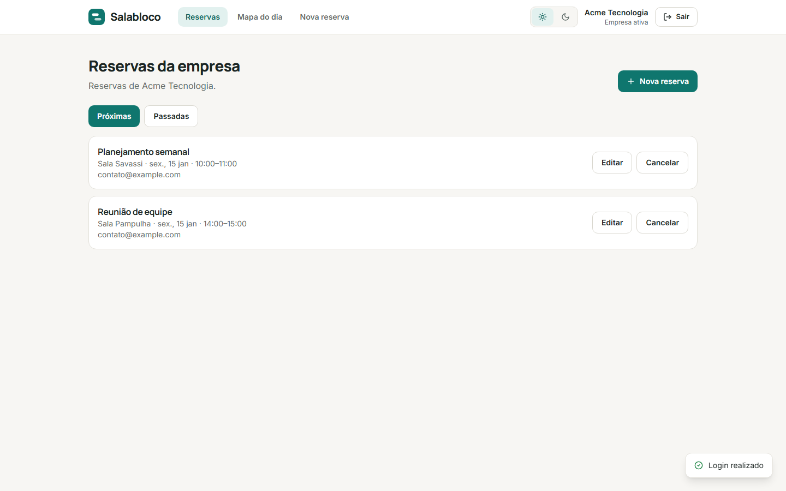
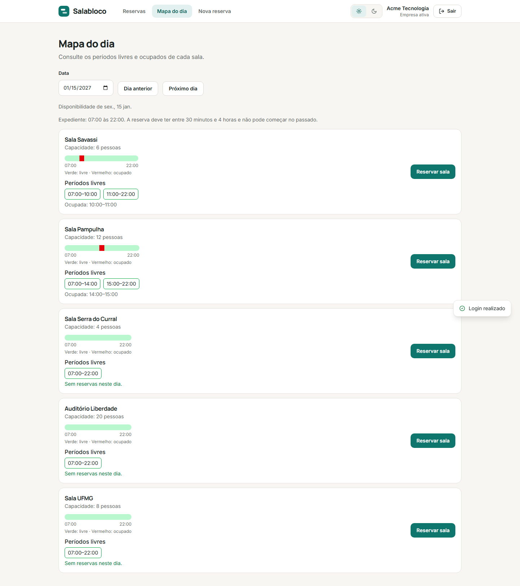
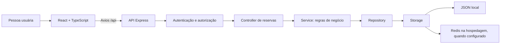
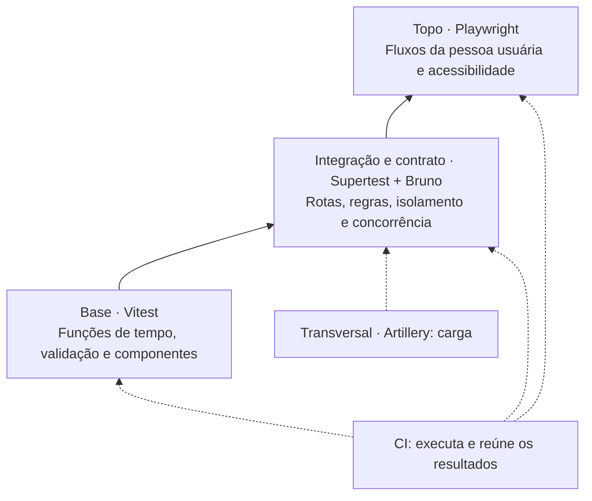
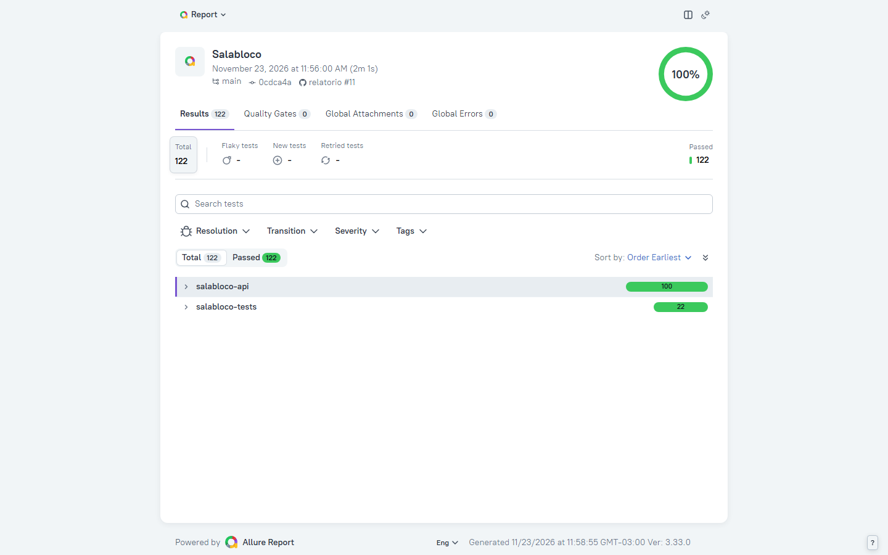

# Salabloco

Aplicação de **reserva de salas de reunião de um coworking**. Várias empresas dividem o espaço: cada uma reserva salas, vê as próprias reservas e cancela quando precisa. O servidor restringe o acesso às reservas da empresa identificada pelo token.

Este é o meu desafio técnico para desenvolvedor júnior: API em Node.js + TypeScript, front-end em React + TypeScript, testes automatizados e documentação das minhas decisões.

> **Estado atual:** a API Express e o front React estão integrados. O projeto possui testes de unidade, API, contrato, interface, acessibilidade e carga. O Redis está configurado na hospedagem; a seção de deploy descreve as condições e limitações dessa persistência.

**[Abrir aplicação](https://salabloco-web.vercel.app/)** · **[Ver relatório Allure](https://felipegabriel7.github.io/salabloco-desafio-tecnico/)** · **[Consultar API](docs/api/api.md)** · **[Decisões de arquitetura](docs/README.md)**

## Acesso publicado

- Front-end: https://salabloco-web.vercel.app/
- Health da API: https://salabloco-api.vercel.app/api/health
- Relatório Allure: https://felipegabriel7.github.io/salabloco-desafio-tecnico/

Para entrar na versão publicada, escolha a empresa e informe o token dela. São **credenciais de demonstração**, públicas de propósito para quem for avaliar, e dão acesso só a dados fictícios:

| Empresa | Token |
| --- | --- |
| Acme Tecnologia | `5a2b5d4de7f879225b437f4fce89d58b0ced09cd89cc575a82958b0c6ac700fe` |
| Lumen Estúdio | `673a1b45bce32e7cf35e0d28529837db2340deb15cf36022e0e8127b0b76d110` |
| Brisa Contabilidade | `1e7f04ef20df85773c43b98d811842942b87884b5635280fa07389b05523b7a0` |

Para rodar localmente, os tokens ficam em `apps/api/.env` (criado a partir do `.env.example`).

## A aplicação

A pessoa seleciona sua empresa, informa o token e acessa apenas as reservas autorizadas. O mapa mostra períodos livres e ocupados sem revelar título, e-mail ou empresa de outras reservas.

| Acesso | Reservas da empresa |
| --- | --- |
|  |  |

**Mapa do dia:** visualização por sala, com expediente, períodos livres e intervalos ocupados.



As imagens de reservas e mapa foram geradas em ambiente local isolado, com dados fictícios; a tela de login foi capturada da aplicação publicada.

## Como rodar

Requisitos: **Node 22.18 ou mais novo**, npm e dependências do Playwright para os testes de navegador. O relatório usa Allure 3 via npm.

```bash
npm ci
npm run setup       # cria os .env a partir dos .env.example (não sobrescreve)
npx playwright install chromium
npm run dev         # API em :3333 e front em :5181
```

Em outro terminal, `npm run validate` executa a suíte local e gera o relatório Allure. Esse comando limpa os resultados anteriores em `tests/allure-results` e inicia uma API de teste na porta 3390; guarde os resultados que precisar antes de executá-lo.

No login, escolha a empresa e informe o token configurado em `apps/api/.env`. O front usa Axios e encaminha `/api` pelo proxy do Vite. Os arquivos `.env` são ignorados pelo Git; os exemplos locais e scripts de teste contêm apenas valores fictícios ([ADR 0013](docs/arquitetura/adr/0013-configuracao-e-segredos.md)).

## O que o sistema faz

- **Reservar** uma sala por um intervalo, com título e e-mail do responsável.
- **Ver as reservas da própria empresa** e cancelá-las.
- **Editar** uma reserva da própria empresa.
- **Ver a disponibilidade** de uma sala em um dia, ou o mapa do dia com todas as salas.
- **Receber sugestões** de outros horários ou salas livres quando há conflito.

### Regras de negócio

| Regra | Detalhe |
| --- | --- |
| Sem sobreposição | Reservas na mesma sala são verificadas na criação e edição, independentemente da empresa. Reservas coladas são válidas |
| Duração | De 30 minutos a 4 horas |
| Expediente | O coworking funciona das 07:00 às 22:00 |
| Passado | Não é possível reservar no passado |
| Isolamento | Cada empresa só vê e altera as próprias reservas |
| Privacidade | A disponibilidade mostra intervalos livres e ocupados, sem dados de quem reservou |
| Fuso | A interface usa o fuso configurado no back-end; o padrão é `America/Sao_Paulo` |

A lista completa, com os casos de borda, está em [requisitos](docs/produto/requisitos.md).

### Dados de demonstração

O seed insere as empresas **Acme**, **Lumen** e **Brisa** e cinco salas fictícias de Belo Horizonte. O armazenamento selecionado é arquivo JSON local ou Redis quando configurado.

## API

`GET /api/health`, `GET /api/companies` e `GET /api/rooms` são públicos. `/api/config` e as demais rotas de negócio exigem `Authorization: Bearer <token>`.

| Rota | Faz |
| --- | --- |
| `GET /api/health` | Verifica se a API está ativa (público) |
| `GET /api/companies` | Lista empresas para o seletor de login (público) |
| `GET /api/config` | Informa o fuso configurado (com token) |
| `GET /api/rooms` | Lista as salas |
| `GET /api/rooms/:id/availability?date=AAAA-MM-DD` | Intervalos livres e ocupados da sala no dia |
| `GET /api/companies/:companyId/bookings` | Reservas da empresa |
| `POST /api/companies/:companyId/bookings` | Cria uma reserva |
| `PUT /api/companies/:companyId/bookings/:id` | Edita uma reserva própria |
| `DELETE /api/companies/:companyId/bookings/:id` | Cancela uma reserva |

A empresa vem sempre do token. Os erros seguem o formato `{ code, message, field? }`, e o `code` é o contrato. Detalhes em [API](docs/api/api.md) e no [OpenAPI](docs/api/openapi.yaml).

## Estrutura do repositório

```
apps/web/     front-end (React, Vite, TypeScript, Tailwind)
apps/api/     servidor (Express 5, TypeScript)
tests/        Playwright (e2e, pages, fixtures), Bruno (contract) e Artillery (performance)
scripts/      setup dos .env e validação local completa
docs/         produto, arquitetura (ADRs), API, qualidade, design
.github/      pipeline de CI/CD
```

Um repositório só, com npm workspaces ([ADR 0009](docs/arquitetura/adr/0009-monorepo.md)).

## Arquitetura

O back-end é um monólito Express. No fluxo de reservas, o controller traduz HTTP, o service aplica as regras e o repository consulta e grava os dados. Em salas, as rotas chamam funções do service/repository diretamente.



O fluxo de criação valida formato, empresa, duração, horário e conflito antes da gravação. A API usa o token para identificar a empresa; o `companyId` enviado na URL é conferido contra essa identidade.

## Minhas decisões

Cada decisão tem um ADR com o motivo, as consequências e as alternativas que descartei. Os principais:

| Decisão | Por quê | ADR |
| --- | --- | --- |
| Express 5 | Framework HTTP e tratamento de erros em handlers assíncronos | [0001](docs/arquitetura/adr/0001-express.md) |
| Rotas, controller, service e repository | Separar HTTP, regras e persistência no módulo de reservas | [0002](docs/arquitetura/adr/0002-estrutura-mvc-servico.md) |
| JSON local com abstração de armazenamento | Persistir entre reinícios locais e permitir a escolha de Redis por configuração | [0003](docs/arquitetura/adr/0003-persistencia.md) |
| A empresa vem do token | O isolamento é decidido no servidor | [0005](docs/arquitetura/adr/0005-autenticacao.md) |
| 404, e não 403, para reserva alheia | Não confirma que o id existe | [0005](docs/arquitetura/adr/0005-autenticacao.md) |
| ISO 8601 com fuso, via `Intl` | Evitar entradas sem fuso e interpretar o dia no fuso configurado | [0006](docs/arquitetura/adr/0006-tempo-e-fuso.md) |
| Verificação e escrita serializadas | Evitar corridas no armazenamento local; no Redis, trava distribuída com gravação condicionada à trava | [0007](docs/arquitetura/adr/0007-concorrencia.md) |
| Redis opcional na Vercel | Compartilhar dados entre instâncias quando configurado | [0016](docs/arquitetura/adr/0016-redis-na-hospedagem.md) |
| Segredos no ambiente | `.env` fora do git; `.env.example` contém valores locais de exemplo | [0013](docs/arquitetura/adr/0013-configuracao-e-segredos.md) |

A lista completa dos 16 ADRs está em [docs/](docs/README.md).

## Testes

Sigo a pirâmide de testes: muitos testes rápidos na base e poucos no navegador ([ADR 0011](docs/arquitetura/adr/0011-estrategia-de-testes.md)).



| Camada | Ferramenta | Onde | Comando |
| --- | --- | --- | --- |
| Unidade do front | Vitest | `apps/web/tests` | `npm test` |
| Unidade, integração e contrato da API | Vitest + Supertest, contratos com zod | `apps/api/tests/{unit,integration,contract}` | `npm run test:api` |
| Contrato de ponta a ponta | Bruno (catálogo, reservas, erros) | `tests/contract/bruno` | `npm run test:contract` |
| Interface | Playwright (BDD, Page Objects, axe) | `tests/e2e`, `tests/pages` | `npm run test:e2e` |
| Performance | Artillery | `tests/performance` | `npm run test:performance` |

- `npm run validate` sobe uma API própria com arquivo JSON temporário, roda as etapas listadas e tenta gerar o relatório. A suíte Redis separada exige Docker/Compose (`npm run test:api:redis`).
- `npm run report:open` abre o **Allure** com os testes da API e da interface. O Bruno gera `tests/reports/bruno.html` e o Artillery gera `tests/reports/artillery.json`.
- Contrato e performance precisam da API rodando (`npm run dev:api`); o `validate` já cuida disso.

### Evidência no Allure

O relatório reúne resultados da API e da interface, com detalhes e anexos das execuções. A imagem é uma captura de uma execução publicada; o [relatório ao vivo](https://felipegabriel7.github.io/salabloco-desafio-tecnico/) pode mostrar resultados diferentes conforme o commit e o pipeline.



## CI/CD

O pipeline fica em [`.github/workflows/ci.yml`](.github/workflows/ci.yml) e roda em todo push e pull request para a `main`.

| Etapa | O que garante |
| --- | --- |
| Tipos, unitários e API | `typecheck`, Vitest do front e da API, build |
| Segurança | Gitleaks, `npm audit` das dependências de produção e checagem de que nenhum token local foi para o bundle do front |
| Análise estática | CodeQL |
| Contrato | Coleção Bruno contra a API rodando |
| API com Redis | A suíte da API contra um Redis real (Redis + SRH no Docker) |
| Interface | Playwright no Chromium |
| Performance | Artillery com limites de p95 e p99 |
| Relatório | Allure consolidado, publicado no GitHub Pages em https://felipegabriel7.github.io/salabloco-desafio-tecnico/, e resumo de cada etapa na página da execução |
| Deploy | Configurado para a `main` após as verificações exigidas; depende dos segredos da Vercel |

O pipeline executa typecheck, build e testes; **não há comando de lint configurado**. A publicação e o resultado de uma execução específica devem ser conferidos na aba Actions.

## Deploy na Vercel

**No ar:** front em https://salabloco-web.vercel.app, API em https://salabloco-api.vercel.app/api/health e relatório de testes em https://felipegabriel7.github.io/salabloco-desafio-tecnico/.

São dois projetos na Vercel, um para a API e outro para o front, publicados pelo pipeline depois que todas as etapas passam.

1. Crie o projeto **salabloco-api** com *Root Directory* `apps/api`. Configure os três `COMPANY_*_TOKEN` e `COWORKING_TIMEZONE` como variáveis de ambiente. Conecte um Upstash Redis e configure `KV_REST_API_URL` e `KV_REST_API_TOKEN`, ou `UPSTASH_REDIS_REST_URL` e `UPSTASH_REDIS_REST_TOKEN`, conforme os nomes fornecidos pela integração.
2. Crie o projeto **salabloco-web** com *Root Directory* `apps/web`. Se a URL da API não for `https://salabloco-api.vercel.app`, ajuste o `rewrites` em [`apps/web/vercel.json`](apps/web/vercel.json). O front chama `/api` no próprio domínio e a Vercel encaminha para a API, sem CORS.
3. Em *Settings → Tokens* da Vercel, gere um token. No GitHub, em *Settings → Secrets and variables → Actions*, crie `VERCEL_TOKEN`, `VERCEL_ORG_ID`, `VERCEL_PROJECT_ID_API` e `VERCEL_PROJECT_ID_WEB` (os IDs ficam em *Settings → General* de cada projeto).
4. Faça push na `main`. O deploy automático pelo Git da Vercel fica desligado (`git.deploymentEnabled: false`): quem publica é o pipeline, e só depois dos testes.

**Persistência na hospedagem:** a integração Redis está configurada no ambiente publicado, conforme a validação de funcionamento. Com URL e token do Redis configurados, a API usa Redis; caso contrário, usa arquivo. Na Vercel, o fallback em `/tmp` é temporário e isolado por instância, portanto **reservas podem desaparecer ou divergir**. Confirme as variáveis no projeto após mudanças de ambiente. No Redis, a gravação só acontece se a instância ainda for dona da trava; se a trava expirou, a operação falha em vez de sobrescrever dados ([ADR 0016](docs/arquitetura/adr/0016-redis-na-hospedagem.md)).

## O que ainda falta

- No login, token de outra empresa (403) mostra "Confira se a API está ativa" em vez de "token inválido".
- Limite de requisições (429) e comparação de token com `timingSafeEqual`.
- Migrar para um banco transacional (Postgres com constraint de exclusão) se o volume crescer, em vez de regravar o banco inteiro a cada escrita.
- Validar a persistência Redis efetiva no ambiente publicado e os casos de transição de fuso/horário de verão.
- Adicionar lint ao CI.

Os itens com teste já escrito aparecem no relatório como pendentes ou como falha esperada.

## O que ficou de fora

Cadastro de empresas e salas por tela, reservas recorrentes, login com senha e i18n. O extra de Firestore com Emulator não foi implementado. Os tokens são fixos, sem rotação nem revogação; o JSON local atende um único processo e não há trilha de auditoria.

## Uso de IA

Usei Claude e Kilo Code como apoio no levantamento de requisitos, nas discussões de arquitetura, na implementação e revisão do front-end, back-end, testes, CI e documentação. As decisões de escopo e os ajustes foram direcionados por mim; o código e os resultados precisam ser compreendidos e validados antes da entrega. Detalhes em [uso de IA](docs/ai/uso-de-ia.md).
