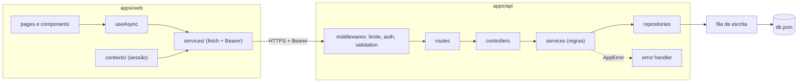
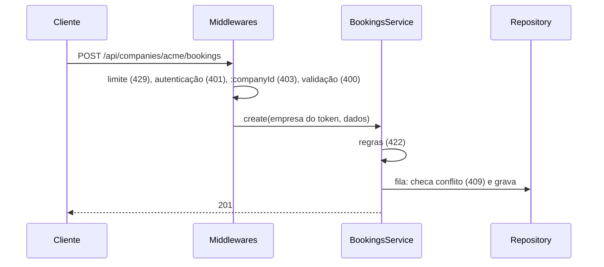

# Arquitetura

Monólito modular: uma API (Express 5) e um front (React), no mesmo repositório com npm workspaces ([ADR 0009](adr/0009-monorepo.md)).

```
salabloco/
├─ apps/
│  ├─ web/     React + Vite + TypeScript + Tailwind
│  └─ api/     Node + TypeScript + Express 5
├─ tests/      Supertest (API), Playwright (E2E), Bruno (contrato), Artillery (performance)
└─ docs/
```

## Visão geral



## Back-end

Módulos por domínio, cada um com as próprias camadas ([ADR 0002](adr/0002-estrutura-mvc-servico.md)).

```
apps/api/src/
├─ modules/
│  ├─ bookings/  routes, controllers, services, repositories, validation
│  ├─ rooms/     routes, controllers, services, repositories
│  └─ auth/      services
├─ shared/       middlewares, errors, utils, config
├─ infrastructure/
│  ├─ persistence/json/   repositories em arquivo, fila, escrita atômica
│  └─ db/                 seed.ts (empresas e salas)
├─ app.ts        monta o Express (sem listen)
└─ server.ts     sobe a porta
```

| Camada | Faz | Não faz |
| --- | --- | --- |
| Routes | Liga método e URL aos middlewares e ao controller | Lógica |
| Middlewares | Limite de requisições, autenticação, validação, erros | Regra de negócio |
| Controller | Chama **um** método do service e devolve a resposta | Regra e acesso a dados |
| Service | **Regra de negócio.** Lança `AppError` | Conhecer `req`, `res` ou Express |
| Repository | **Acesso a dados** (interface) | Decidir regra |

O controller conhece o service, o service conhece a **interface** do repository, e só `infrastructure/` sabe que existe um arquivo JSON. `app.ts` não chama `listen`: assim os testes importam o app sem abrir porta.

## Front-end

```
apps/web/src/
├─ components/   componentes reutilizáveis (inclui a rota protegida)
├─ contexts/     sessão e tema (Context API)
├─ hooks/        useAsync
├─ pages/        telas
├─ services/     funções Axios, tipos da API e conversão de horário
├─ routes.ts     paths React e prefill de navegação
├─ App.tsx       provedores e rotas
└─ main.tsx
```

Testes unitários do front ficam em `apps/web/tests/`, separados de `src/`.

## Fluxo de uma requisição



Erros viram `{ code, message, field? }` no error handler. Erro inesperado vira 500 genérico, sem stack trace ([ADR 0008](adr/0008-contrato-de-erros.md)).

## Dados

- Um único arquivo, `db.json` (fora do git), guarda **empresas, salas e reservas**. O back-end o cria e o semeia com empresas e salas na subida (`seed.ts`, versionado, idempotente, nunca mexe em reservas) ([ADR 0003](adr/0003-persistencia.md)).
- Os **tokens** das empresas vêm do ambiente e nunca são gravados no arquivo.
- Empresa: `id`, `name`. Sala: `id`, `name`, `capacity`.
- Reserva: `id`, `companyId`, `roomId`, `startsAt`, `endsAt`, `title`, `responsibleEmail`, `createdAt`. Datas em ISO 8601 com fuso explícito.

## Onde cada preocupação é garantida

| Preocupação | Mecanismo | ADR |
| --- | --- | --- |
| Regra de negócio | Services com relógio injetado | [0002](adr/0002-estrutura-mvc-servico.md) |
| Isolamento entre empresas | Empresa vem do token; filtro por empresa; 404 no recurso alheio | [0005](adr/0005-autenticacao.md) |
| Sem corrida na criação | Fila de escrita com checagem e gravação juntas | [0007](adr/0007-concorrencia.md) |
| Arquivo íntegro | Escrita atômica | [0003](adr/0003-persistencia.md) |
| Força bruta | Limite de requisições com bloqueio escalonado | [0012](adr/0012-limite-de-requisicoes.md) |
| Tempo correto | `Intl`, ISO com fuso | [0006](adr/0006-tempo-e-fuso.md) |
| Segredos | `.env` fora do git, validado no boot | [0013](adr/0013-configuracao-e-segredos.md) |

## Evolução

| Se... | Eu faria |
| --- | --- |
| A complexidade crescer | Casos de uso no lugar de services grandes |
| Persistência virar requisito sério | Outro repository (SQL ou Firestore). Services não mudam |
| Houver mais de uma instância | Limite e fila em armazenamento compartilhado |
| Muitas rotas e contratos | Fastify ou Nest |
